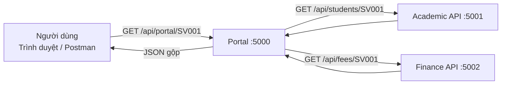
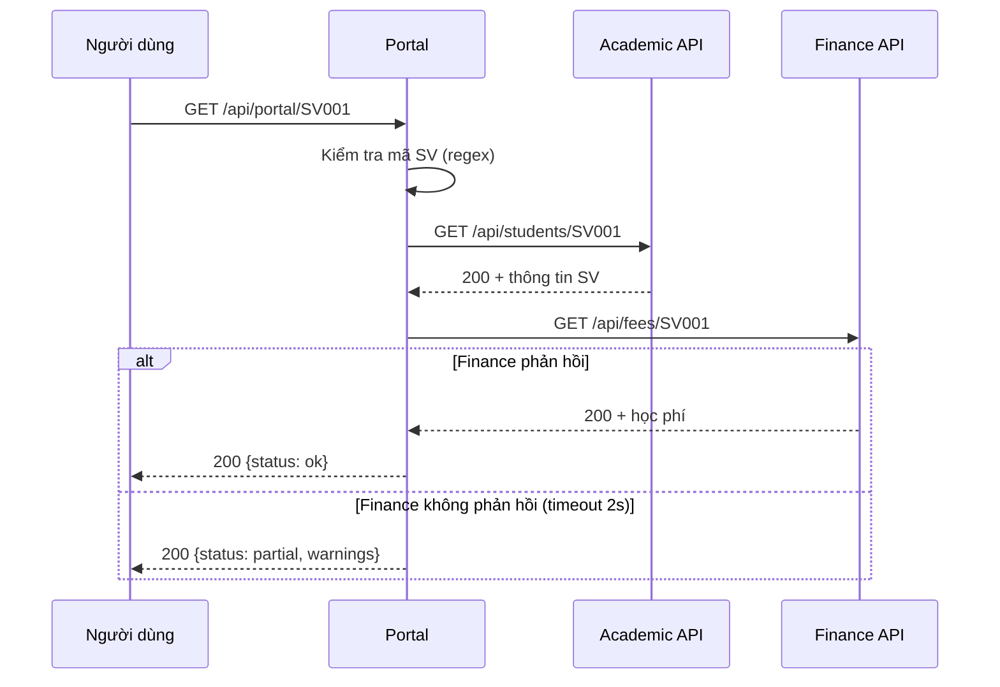

# BÀI TẬP LỚN – NHẬP MÔN TÍCH HỢP HỆ THỐNG
## Chủ đề 04: Tích hợp ứng dụng thông qua REST API và cổng thông tin Portal

> **Dành cho cả 3 thành viên.** Đọc mục 1–8 trước (khoảng 20 phút) để hiểu dự án và chạy được demo. Sau đó đọc kỹ **mục 10 (phân công)** để biết phần việc của mình. Mục 9 là *quy ước chung* mà cả nhóm phải thống nhất trong buổi họp đầu tiên.

## Mục lục
1. Tổng quan dự án
2. Đối chiếu yêu cầu của đề
3. Kiến thức cần nắm
4. Kiến trúc và luồng dữ liệu
5. Hợp đồng API (ví dụ request/response)
6. Cấu trúc thư mục
7. Cài đặt và chạy lại demo
8. Kịch bản và ma trận kiểm thử
9. Quy ước chung của nhóm (mỗi người một máy)
10. Phân công nhiệm vụ
11. Cấu trúc báo cáo
12. Lộ trình thực hiện
13. Chuẩn bị thuyết trình và vấn đáp
14. Checklist nộp bài
15. Xử lý sự cố thường gặp
16. Hạn chế và hướng mở rộng
17. Công cụ AI đã sử dụng

---

## 1. Tổng quan dự án

Giả lập một trường đại học có **hai hệ thống độc lập**:

- **Academic** – quản lý thông tin sinh viên (họ tên, ngành, email, GPA).
- **Finance** – quản lý học phí (tổng phí, đã nộp, còn nợ).

Hai hệ thống không biết gì về nhau và có dữ liệu riêng. Ta xây thêm **Portal**: người dùng nhập mã sinh viên, Portal gọi API của cả hai hệ thống rồi **gộp kết quả** hiển thị trên một trang. Nếu một hệ thống không phản hồi, Portal vẫn hiển thị phần còn lại kèm cảnh báo.

**Ba thành phần, ba cổng**

| Thành phần | Cổng | Vai trò |
|---|---|---|
| Portal | 5000 | Giao diện web + API tổng hợp |
| Academic API | 5001 | Cung cấp thông tin sinh viên |
| Finance API | 5002 | Cung cấp và tạo khoản học phí |

Công nghệ: Python, Flask (xây API), requests (Portal gọi API), Postman (trình diễn và kiểm thử). **Toàn bộ dữ liệu là dữ liệu giả lập**, không có thông tin cá nhân thật.

---

## 2. Đối chiếu yêu cầu của đề

| Yêu cầu của đề | Đáp ứng bằng |
|---|---|
| Academic API cung cấp thông tin sinh viên | `academic_api.py` |
| Finance API cung cấp khoản học phí | `finance_api.py` |
| Portal đơn giản: nhập mã SV, lấy dữ liệu từ hai dịch vụ và hiển thị kết quả tổng hợp | `portal.py` |
| Kiểm tra đầu vào | Regex `^SV\d{3}$`; kiểm tra body của POST |
| Xử lý lỗi khi một API không phản hồi | Timeout 2 giây, trả `partial` hoặc `503` |
| ≥ 3 API endpoint chức năng rõ ràng | 5 endpoint nghiệp vụ + 2 endpoint `/health` |
| Postman: thành công / không tìm thấy / đầu vào không hợp lệ | Postman Collection (mục 10) |
| Sơ đồ luồng yêu cầu | Sơ đồ tuần tự (mục 4) |
| Ít nhất một tình huống lỗi được kiểm thử | TC07, TC08 và các test bổ sung (mục 8) |
| Báo cáo, mã nguồn, hướng dẫn chạy lại, bằng chứng kiểm thử | Mục 11, 7, 8 |
| Dữ liệu giả lập, không dùng dữ liệu cá nhân thật | 10 sinh viên mẫu |
| Nêu công cụ AI đã dùng | Mục 17 |

---

## 3. Kiến thức cần nắm (mỗi người đều phải giải thích được)

- **Application Interface Integration**: các ứng dụng tích hợp với nhau qua *giao diện lập trình* (API) do mỗi ứng dụng công bố, không đụng vào bên trong nhau.
- **REST API**: tài nguyên định danh bằng URL (`/api/students/SV001`), thao tác bằng HTTP method, dữ liệu trao đổi dạng **JSON**.
- **Endpoint, Request, Response**: endpoint là địa chỉ của một chức năng; request gồm method, URL, header, body; response gồm mã trạng thái, header, body.
- **HTTP Methods**: `GET` (đọc), `POST` (tạo mới); ngoài ra `PUT/PATCH` (sửa), `DELETE` (xoá).
- **Mã trạng thái**:

| Mã | Ý nghĩa | Dùng trong demo khi |
|---|---|---|
| 200 | OK | Đọc dữ liệu thành công |
| 201 | Created | POST tạo khoản phí thành công |
| 400 | Bad Request | Mã SV sai định dạng, body POST sai |
| 404 | Not Found | Không có sinh viên / chưa có khoản phí |
| 503 | Service Unavailable | Portal không gọi được dịch vụ nào |

- **Ba cách tích hợp cần phân biệt** (đề yêu cầu rõ):

| Tiêu chí | Truy cập trực tiếp CSDL | Tích hợp qua API | Tích hợp hiển thị tại Portal |
|---|---|---|---|
| Cách làm | A đọc thẳng bảng của B | A gọi endpoint do B công bố | Portal gom thông tin từ nhiều nguồn lên một giao diện |
| Phụ thuộc | Rất chặt vào cấu trúc bảng | Chỉ phụ thuộc "hợp đồng" API | Phụ thuộc cả API và cách hiển thị |
| Khi B đổi schema | A hỏng ngay | A không ảnh hưởng nếu API giữ nguyên | Tuỳ |
| Kiểm soát quyền | Khó | Kiểm soát tại endpoint | Tuỳ |

  > Demo của ta là **Portal gọi API**, tức *kết hợp* cách 2 và cách 3. Phải nói rõ điều này khi thuyết trình.

- **Graceful degradation** (giảm cấp êm): một dịch vụ chết thì Portal vẫn phục vụ phần còn lại, thay vì sập hoàn toàn.
- **Timeout**: giới hạn thời gian chờ để Portal không bị treo khi dịch vụ chậm hoặc không phản hồi.
- **Coupling**: mức độ phụ thuộc giữa các hệ thống. Địa chỉ dịch vụ gắn cứng trong mã là một dạng phụ thuộc chặt.

---

## 4. Kiến trúc và luồng dữ liệu





**Các kịch bản của Portal**

| Tình huống | Portal trả về |
|---|---|
| Mã SV sai định dạng (`abc`) | `400 INVALID_ID` (không gọi API nào) |
| Không có sinh viên | `404 NOT_FOUND` |
| Có sinh viên + có học phí | `200`, `status: ok` |
| Có sinh viên, chưa có học phí (vd `SV008`) | `200`, `status: partial` + cảnh báo |
| Finance sập | `200`, `status: partial`, vẫn có thông tin SV |
| Academic sập (Finance còn) | `200`, `status: partial`, chỉ có học phí |
| Cả hai sập | `503 ALL_DOWN` |

---

## 5. Hợp đồng API

> **Đây là "hợp đồng" chung của cả nhóm.** Ai muốn đổi URL, tên trường JSON hoặc mã lỗi phải báo cả nhóm và ghi vào `CHANGELOG.md` (xem mục 9).

### 5.1 Academic API (5001)

| Method | URL | Mô tả | Mã trả về |
|---|---|---|---|
| GET | `/health` | Kiểm tra dịch vụ còn sống | 200 |
| GET | `/api/students` | Danh sách sinh viên | 200 |
| GET | `/api/students/{id}` | Chi tiết một sinh viên | 200, 400, 404 |

`GET /api/students/SV001` → `200`
```json
{
  "student_id": "SV001",
  "full_name": "Nguyễn Văn An",
  "major": "Công nghệ thông tin",
  "email": "sv001@student.edu.vn",
  "gpa": 3.2
}
```

### 5.2 Finance API (5002)

| Method | URL | Mô tả | Mã trả về |
|---|---|---|---|
| GET | `/health` | Kiểm tra dịch vụ còn sống | 200 |
| GET | `/api/fees/{id}` | Học phí của sinh viên | 200, 400, 404 |
| POST | `/api/fees/{id}` | Tạo khoản học phí mới | 201, 400 |

`GET /api/fees/SV002` → `200`
```json
{
  "student_id": "SV002",
  "fees": [
    {"fee_id": "F002", "term": "HK1-2026", "amount": 12500000, "paid": 5000000}
  ],
  "total": 12500000,
  "paid": 5000000,
  "balance": 7500000
}
```

`POST /api/fees/SV006` với body `{"term": "HK1-2026", "amount": 9000000}` → `201` (trả về khoản phí vừa tạo).
Body sai (thiếu `term` hoặc `amount <= 0`) → `400 INVALID_BODY`.

### 5.3 Portal (5000)

| Method | URL | Mô tả | Mã trả về |
|---|---|---|---|
| GET | `/` | Giao diện web tra cứu | 200 |
| GET | `/api/portal/{id}` | Gộp dữ liệu hai dịch vụ | 200, 400, 404, 503 |

`GET /api/portal/SV001` khi Finance sập → `200`
```json
{
  "status": "partial",
  "student": {"student_id": "SV001", "full_name": "Nguyễn Văn An", "...": "..."},
  "finance": null,
  "warnings": ["Không lấy được học phí (Finance)"]
}
```

### 5.4 Định dạng lỗi chung

```json
{"error": "NOT_FOUND", "message": "Không có sinh viên SV999"}
```
Các giá trị `error`: `INVALID_ID`, `NOT_FOUND`, `INVALID_BODY`, `ALL_DOWN`, `SERVICE_UNAVAILABLE`.

### 5.5 Dữ liệu mẫu

- Academic: 10 sinh viên `SV001`–`SV010`.
- Finance: có học phí cho `SV001`–`SV005`. Dùng `SV008` để thử trường hợp "có sinh viên nhưng chưa có phí".

---

## 6. Cấu trúc thư mục

```
bt04/
├── academic_api.py     # Academic API (5001)
├── finance_api.py      # Finance API (5002)
├── portal.py           # Portal: backend gộp dữ liệu + giao diện web (5000)
├── test_demo.py        # 8 test tự động (có kịch bản tắt dịch vụ)
├── requirements.txt    # flask, requests
├── CHANGELOG.md        # ghi các thay đổi ảnh hưởng đến người khác
├── .gitignore          # (dùng nếu có Git)
├── README.md           # tài liệu này
├── logs/               # portal.log tự sinh khi chạy
├── docs/               # (tự tạo) sơ đồ, báo cáo, slide
├── postman/            # (tự tạo) Postman Collection (.json)
└── evidence/           # (tự tạo) ảnh chụp, log minh chứng
```

---

## 7. Cài đặt và chạy lại demo

**Yêu cầu:** Python 3.10 trở lên (cả nhóm dùng cùng bản, xem mục 9).

### 7.1 Cài đặt (làm một lần, dùng virtual environment)

Windows:
```bash
python -m venv venv
venv\Scripts\activate
pip install -r requirements.txt
```
macOS / Linux:
```bash
python3 -m venv venv
source venv/bin/activate
pip install -r requirements.txt
```

### 7.2 Chạy demo

Mở **3 terminal**, mỗi terminal đều đã kích hoạt venv và đứng trong thư mục `bt04`:

```bash
python academic_api.py   # terminal 1 – cổng 5001
python finance_api.py    # terminal 2 – cổng 5002
python portal.py         # terminal 3 – cổng 5000
```
(macOS/Linux dùng `python3` nếu `python` không có.)

Mở trình duyệt: `http://127.0.0.1:5000` và nhập thử `SV001`, `SV999`, `abc`, `SV008`.

Thử bằng dòng lệnh:
```bash
curl http://127.0.0.1:5000/api/portal/SV002     # thành công
curl http://127.0.0.1:5000/api/portal/SV999     # 404
curl http://127.0.0.1:5000/api/portal/abc       # 400
```

### 7.3 Thử tình huống lỗi

Tắt terminal 2 (Finance) rồi gọi lại `/api/portal/SV001` → thấy `status: partial`. Mở `logs/portal.log` để thấy dòng ghi lỗi kết nối.

### 7.4 Chạy kiểm thử tự động

```bash
python test_demo.py     # tự bật/tắt 3 dịch vụ; kỳ vọng: 8/8 test đạt
```
Lưu ý: dừng các dịch vụ đang chạy tay (7.2) trước khi chạy test, vì test dùng cùng các cổng.

---

## 8. Kịch bản và ma trận kiểm thử

### 8.1 Test tự động hiện có (`test_demo.py`)

| Mã | Mô tả | Kết quả mong đợi |
|---|---|---|
| TC01 | `GET /api/portal/SV002` | 200, `status: ok` |
| TC02 | `GET /api/portal/SV999` | 404 |
| TC03 | `GET /api/portal/abc` | 400 |
| TC04 | `GET /api/portal/SV008` (có SV, chưa có phí) | 200, `status: partial` |
| TC05 | `POST /api/fees/SV006` body hợp lệ | 201 |
| TC06 | `POST /api/fees/SV006` body sai | 400 |
| TC07 | Tắt Finance, gọi `SV001` | 200, `partial`, vẫn có thông tin SV |
| TC08 | Tắt cả Academic và Finance | 503 |

### 8.2 Test nên bổ sung

- Academic sập, Finance còn → `partial`, chỉ có học phí.
- Finance **chậm** hơn timeout (dùng tham số `?delay=` do A thêm) → Portal không treo, trả `partial`.
- Kiểm tra các khoản phí POST rồi GET lại thấy khoản mới.
- Các mã SV biên: `SV000`, `SV1`, `sv001` (chữ thường), chuỗi rỗng, ký tự đặc biệt.

### 8.3 Mẫu ma trận kiểm thử cho báo cáo

| Mã TC | Mô tả | Đầu vào | Kết quả mong đợi | Kết quả thực tế | Đạt/Không | Minh chứng |
|---|---|---|---|---|---|---|
| TC01 | Tra cứu thành công | `SV002` | 200, ok | | | `evidence/TC01_*.png` |

### 8.4 Danh sách request Postman cần có

`SV002 → 200`, `SV999 → 404`, `abc → 400`, `SV008 → partial`, `POST fees → 201`, `POST body sai → 400`, và kịch bản Finance sập. Xuất Collection ra `postman/` dưới dạng JSON.

---

## 9. Quy ước chung của nhóm (mỗi người một máy)

**Họp đầu tiên phải chốt các mục dưới đây.**

### 9.1 Môi trường
- [ ] Cùng phiên bản Python (đề xuất 3.10 hoặc 3.11). Ghi phiên bản đã chọn: `________`
- [ ] Luôn cài thư viện bằng `requirements.txt` trong virtual environment (mục 7.1).
- [ ] Giữ nguyên cổng 5000, 5001, 5002. Nếu cổng bị trùng trên máy ai thì báo nhóm, không tự sửa cứng.
- [ ] Không dùng lệnh riêng của một hệ điều hành trong tài liệu và mã (tránh `mkdir -p`, đường dẫn kiểu `C:\...`).

### 9.2 Hợp đồng API
- [ ] Mục 5 là chuẩn chung. Muốn đổi URL, tên trường JSON hay mã lỗi → báo nhóm **trước khi** đổi và ghi vào `CHANGELOG.md`.
- [ ] Người đổi API chịu trách nhiệm cập nhật Postman và báo người phụ thuộc (A → B, C).

### 9.3 Quy trình làm việc
- [ ] **Một người giữ bản chính** (đề xuất C) và chịu trách nhiệm ghép. Người khác gửi file đã sửa cho người này.
- [ ] Mỗi người **chỉ sửa file thuộc phần mình** (mục 10). Cần sửa file của người khác thì nhắn trước.
- [ ] Nếu gửi zip: đặt tên có ngày giờ, ví dụ `bt04_v3_1211.zip`.
- [ ] Họp tối thiểu **1 lần mỗi tuần**; đầu buổi mỗi người báo: đã xong gì, đang vướng gì, có đổi gì ở API không.
- [ ] **Git là tuỳ chọn.** Đề không bắt buộc. Nếu dùng: mỗi người một nhánh `feature/a-...`, `feature/b-...`, `feature/c-...`; trước khi làm `git pull`, làm xong `git add .`, `git commit -m "..."`, `git push`. Nếu không dùng: dùng một thư mục chung trên Drive/OneDrive và tuân thủ quy tắc "mỗi người một file" ở trên.

### 9.4 Chuẩn bằng chứng và tài liệu
- [ ] Ảnh chụp, log, file Postman lưu ở `evidence/` và `postman/`. Đặt tên có quy tắc: `TC01_thanhcong.png`, `TC07_financedown.png`.
- [ ] Dùng một mẫu ma trận kiểm thử duy nhất (mục 8.3).
- [ ] Báo cáo viết chung trên một nơi (Google Docs hoặc OneDrive Word) để cùng chỉnh sửa mà không phải ghép nhiều file.

### 9.5 Kiểm thử chéo
- [ ] Sau mỗi thay đổi lớn, **ít nhất một người khác** tải bản mới về và chạy `python test_demo.py` trên máy mình. Đạt 8/8 mới coi là xong.
- [ ] Tuần cuối: chạy lại **từ đầu trên một máy sạch** (hoặc máy của người chưa từng chạy) theo đúng README.

---

## 10. Phân công nhiệm vụ

> Mã nguồn nền đã có sẵn. **Mỗi người phải chạy được toàn bộ demo trước**, rồi mới làm phần của mình. Phần "Nâng cấp" là nơi lấy điểm cao ở tiêu chí *Demo (35%)* và *Thiết kế (15%)*. Mỗi người tự viết phần báo cáo về phần mình làm để khi vấn đáp trả lời được tự nhiên.

### Tổng quan phân công

| | **A** | **B** | **C** |
|---|---|---|---|
| Code | Academic + Finance | Portal | Mở rộng `test_demo.py` |
| Postman | Academic + Finance | Portal + kịch bản lỗi | Tổng hợp, kiểm tra chéo |
| Sơ đồ | Sơ đồ kiến trúc | Sơ đồ tuần tự (3 luồng) | Bảng so sánh 3 cách tích hợp |
| Báo cáo | Thiết kế API + cài đặt Academic/Finance | Cài đặt Portal + xử lý lỗi + hướng dẫn chạy | Chương 1, 2, 3, 8 + **ghép toàn bộ** |
| Khác | | | Slide, mục công cụ AI, rà checklist |

### 👤 Thành viên A – Backend dữ liệu (Academic + Finance)

**File phụ trách:** `academic_api.py`, `finance_api.py`

**Bắt buộc**
- [ ] Giải thích được từng endpoint và từng nhánh trả 400/404/201.
- [ ] Rà dữ liệu giả lập: đủ 10 sinh viên, hợp lý, không dùng dữ liệu thật.
- [ ] Viết **bảng mô tả API** (endpoint, method, tham số, ví dụ request/response, mã lỗi) cho báo cáo.
- [ ] Tạo **Postman Collection cho Academic và Finance** (200, 400, 404, 201) và chụp ảnh vào `evidence/`.
- [ ] Vẽ **sơ đồ kiến trúc** (có thể dựa trên sơ đồ ở mục 4, vẽ lại bằng draw.io hoặc PlantUML).
- [ ] Viết chương *Thiết kế API* và *Cài đặt Academic/Finance* trong báo cáo.

**Nâng cấp (nên làm ≥ 2)**
- [ ] Thêm tiền tố `/api/v1/...` (báo B và C ngay khi đổi).
- [ ] Viết `openapi.yaml` mô tả Academic và Finance.
- [ ] Thêm `PUT` hoặc `DELETE` cho khoản học phí.
- [ ] Thêm tham số `?delay=3` cho Finance để giả lập chậm (phục vụ test timeout của B).

**Phải giải thích được khi vấn đáp**
- Vì sao Finance không đọc chung CSDL với Academic mà phải qua API?
- Vì sao sai định dạng trả 400 còn không tồn tại trả 404?
- Vì sao POST thành công trả 201 chứ không phải 200?

### 👤 Thành viên B – Portal và xử lý lỗi

**File phụ trách:** `portal.py`

**Bắt buộc**
- [ ] Giải thích được hàm `call()` (timeout, bắt lỗi, ghi log) và logic `partial` / `ALL_DOWN`.
- [ ] Tạo **Postman Collection cho Portal và các kịch bản lỗi** (Finance sập, Academic sập, cả hai sập, timeout).
- [ ] Chụp ảnh giao diện web ở các trường hợp: thành công, 404, 400, Finance sập.
- [ ] Chọn các dòng `logs/portal.log` làm minh chứng cho từng tình huống.
- [ ] Vẽ **sơ đồ tuần tự** cho 3 luồng: thành công, một API lỗi, không tìm thấy.
- [ ] Viết chương *Cài đặt Portal và xử lý lỗi* và *Hướng dẫn cài đặt, chạy lại* trong báo cáo.

**Nâng cấp (nên làm ≥ 2)**
- [ ] Đưa `ACADEMIC_URL`, `FINANCE_URL`, `TIMEOUT` ra **biến môi trường** (`os.environ.get`).
- [ ] Gọi hai API **song song** (`concurrent.futures.ThreadPoolExecutor`) và đo thời gian so với tuần tự.
- [ ] Thử độ trễ bằng `?delay=` của A để chứng minh Portal không treo khi vượt timeout.
- [ ] Thêm **retry** đơn giản (tối đa 1–2 lần) cho lỗi tạm thời.

**Phải giải thích được khi vấn đáp**
- Portal có phải điểm lỗi tập trung không? Giảm rủi ro thế nào?
- Vì sao trả `partial` thay vì báo lỗi hoàn toàn khi Finance sập?
- Khi nào dùng 502/504 thay cho 503?
- Gọi tuần tự và song song khác nhau gì về thời gian phản hồi?

### 👤 Thành viên C – Tổng hợp, kiểm thử, báo cáo

**Phụ trách:** `docs/`, `test_demo.py`, ma trận kiểm thử, báo cáo tổng, slide

**Bắt buộc**
- [ ] Viết chương 1 (giới thiệu), 2 (cơ sở lý thuyết), 3 (so sánh ba cách tích hợp), 8 (nhận xét, hạn chế).
- [ ] Lập **ma trận kiểm thử** tổng hợp theo mẫu mục 8.3, đối chiếu với ảnh minh chứng của A và B.
- [ ] Mở rộng `test_demo.py` (test Academic sập, test timeout, test POST rồi GET lại).
- [ ] **Giữ bản chính** và ghép báo cáo, kiểm tra thống nhất về định dạng.
- [ ] Làm slide thuyết trình; viết mục *Công cụ AI đã sử dụng*.
- [ ] Rà checklist nộp bài (mục 14) trước khi nộp.

**Nâng cấp (nên làm ≥ 1)**
- [ ] Làm bảng so sánh ba cách tích hợp kèm ví dụ minh hoạ bằng chính demo.
- [ ] Đo và trình bày bảng so sánh thời gian phản hồi (tuần tự/song song, bình thường/chậm).

**Phải giải thích được khi vấn đáp**
- Mỗi test case kiểm tra điều gì và vì sao quan trọng?
- Luồng một request đi qua các thành phần nào, theo thứ tự nào?
- Demo còn thiếu gì so với hệ thống thực tế?

### 🤝 Việc chung

- Mỗi người chạy được cả 3 dịch vụ và `test_demo.py` **trên máy của mình**.
- **Tuần cuối dành riêng cho hỏi chéo**: A hỏi phần B, B hỏi phần C, C hỏi phần A. Đề chấm từng cá nhân.
- Nếu năng lực code lệch nhau: người yếu code nhận nhiều phần sơ đồ, Postman và báo cáo hơn, nhưng vẫn phải chạy được toàn bộ demo và giải thích được luồng.

---

## 11. Cấu trúc báo cáo

| Chương | Nội dung | Phụ trách |
|---|---|---|
| 1 | Giới thiệu bài toán và mục tiêu | C |
| 2 | Cơ sở lý thuyết (REST, JSON, HTTP, mã trạng thái, timeout, coupling) | C |
| 3 | So sánh truy cập CSDL / API / Portal | C |
| 4 | Phân tích và thiết kế: sơ đồ kiến trúc, sơ đồ tuần tự, thiết kế API | A (kiến trúc, API) + B (tuần tự) |
| 5 | Cài đặt Academic/Finance | A |
| 6 | Cài đặt Portal và xử lý lỗi | B |
| 7 | Kiểm thử: ma trận, ảnh Postman, log, nhận xét kết quả | C tổng hợp, A/B cung cấp minh chứng |
| 8 | Hướng dẫn cài đặt và chạy lại | B |
| 9 | Nhận xét, hạn chế, hướng mở rộng | Cả nhóm |
| 10 | Công cụ AI đã sử dụng | C |
| Phụ lục | Mã nguồn chính, Postman Collection, log | Cả nhóm |

---

## 12. Lộ trình thực hiện (điều chỉnh theo hạn nộp thực tế)

| Giai đoạn | Việc cần xong |
|---|---|
| Tuần 1 | Cả nhóm đọc README, chạy được demo, hiểu kiến thức mục 3. Họp chốt mục 9. Chia việc theo mục 10. |
| Tuần 2 | A, B làm phần bắt buộc và nâng cấp; C viết chương 1–3 và vẽ khung báo cáo. |
| Tuần 3 | Hoàn thiện nâng cấp; kiểm thử đầy đủ; thu thập bằng chứng; ghép báo cáo; làm slide. |
| Tuần 4 | Chạy lại từ đầu trên máy sạch; hỏi chéo; tập thuyết trình; rà checklist; nộp. |

---

## 13. Chuẩn bị thuyết trình và vấn đáp

**Trình tự demo gợi ý (5–7 phút)**
1. Giới thiệu bài toán và sơ đồ kiến trúc (1 phút).
2. Bật 3 dịch vụ, tra `SV002` trên Portal → thành công.
3. Thử `SV999` (404) và `abc` (400).
4. Dùng Postman gọi trực tiếp một API để cho thấy request/response.
5. **Tắt Finance trước mặt giảng viên**, tra lại `SV001` → Portal vẫn hiển thị, kèm cảnh báo; mở log.
6. Trình bày bảng so sánh ba cách tích hợp và hạn chế.

**Câu hỏi giảng viên hay hỏi**
- Vì sao dùng API mà không đọc thẳng CSDL của Finance?
- Khi Finance sập, Portal xử lý thế nào? Vì sao `partial`?
- Mã 400, 404, 503 khác nhau thế nào?
- Địa chỉ dịch vụ đang gắn cứng trong mã, giải pháp là gì? (biến môi trường, file cấu hình, service discovery)
- Portal có là điểm lỗi tập trung không? Gọi tuần tự hay song song tốt hơn?
- Nếu hai hệ thống đổi tên trường JSON thì ảnh hưởng đến đâu? (versioning)
- Demo này khác gì hệ thống thật? (CSDL, xác thực, giám sát, retry)
- Thành viên X làm phần nào? Hãy giải thích đoạn mã này (hỏi chéo từng người).

---

## 14. Checklist nộp bài (đối chiếu với đề)

- [ ] Báo cáo: bài toán, kiến thức, kiến trúc, luồng dữ liệu
- [ ] Mã nguồn, tệp cấu hình, dữ liệu giả lập (≥ 10 sinh viên)
- [ ] Hướng dẫn cài đặt, chạy lại (mục 7)
- [ ] ≥ 3 endpoint rõ chức năng
- [ ] Postman: thành công / không tìm thấy / đầu vào không hợp lệ
- [ ] Ít nhất 1 tình huống lỗi được kiểm thử (một API không phản hồi)
- [ ] Sơ đồ luồng yêu cầu
- [ ] Bằng chứng kiểm thử và nhận xét kết quả
- [ ] Dữ liệu 100% giả lập, không có thông tin cá nhân thật
- [ ] Mục nêu công cụ AI đã dùng
- [ ] Chạy lại thành công trên máy sạch theo README
- [ ] Mỗi thành viên giải thích được toàn bộ hệ thống

---

## 15. Xử lý sự cố thường gặp

| Hiện tượng | Nguyên nhân và cách xử lý |
|---|---|
| `Address already in use` / cổng đang bận | Đã có tiến trình dùng cổng đó (kể cả lần chạy trước). Đóng terminal cũ hoặc tắt tiến trình. Không chạy `test_demo.py` khi đang bật dịch vụ bằng tay. |
| `ModuleNotFoundError: flask` | Chưa kích hoạt venv hoặc chưa `pip install -r requirements.txt`. |
| `python` không chạy trên Mac/Linux | Dùng `python3` thay thế. |
| Portal luôn báo "không phản hồi" | Academic hoặc Finance chưa chạy, hoặc chạy sai cổng. Kiểm tra `http://127.0.0.1:5001/health` và `:5002/health`. |
| Tiếng Việt hiển thị lỗi trong terminal Windows | Dùng Windows Terminal/VS Code terminal hoặc chạy `chcp 65001`. |
| Test `test_demo.py` đứng yên | Cổng bị chiếm; đóng mọi dịch vụ đang chạy rồi thử lại. |

---

## 16. Hạn chế và hướng mở rộng

**Hạn chế hiện tại (nên nêu thẳng trong báo cáo)**
- Dữ liệu lưu trong bộ nhớ (dict), chưa dùng CSDL thật; dữ liệu POST mất khi khởi động lại dịch vụ.
- Chưa có xác thực, phân quyền.
- Chưa có retry, circuit breaker, caching.
- Server phát triển của Flask, không dùng cho môi trường thật.

**Hướng mở rộng**
- API Gateway, xác thực bằng API key hoặc JWT.
- Thay dict bằng CSDL (SQLite/MySQL).
- Caching ở Portal; circuit breaker khi một dịch vụ lỗi kéo dài.
- Chuyển các luồng không cần phản hồi tức thời sang bất đồng bộ (message queue).

---

## 17. Công cụ AI đã sử dụng

> Đề bài cho phép dùng AI để tìm hiểu lý thuyết, hỗ trợ viết mã và gỡ lỗi, nhưng **nhóm phải tự kiểm tra tính đúng đắn và giải thích được** giải pháp đã nộp. Ghi ngắn gọn, trung thực:

| Công cụ | Dùng vào việc | Phần nhóm đã tự kiểm tra/chỉnh sửa |
|---|---|---|
| Claude | Dựng khung mã nguồn nền, soạn README và kế hoạch | (nhóm điền) |
# thht_nhom17
